<div align="center">

# Object

**Notes that are objects. Objects that are plain Markdown files.**

A local-first workspace with types, properties, views, a calendar, tasks, a graph, whiteboards and AI agents.<br>
Everything lives in a folder of `.md` files on your own disk. No account, no cloud, no sync.


<br>

<picture>
  <source media="(prefers-color-scheme: dark)" srcset="docs/images/object-dark.webp">
  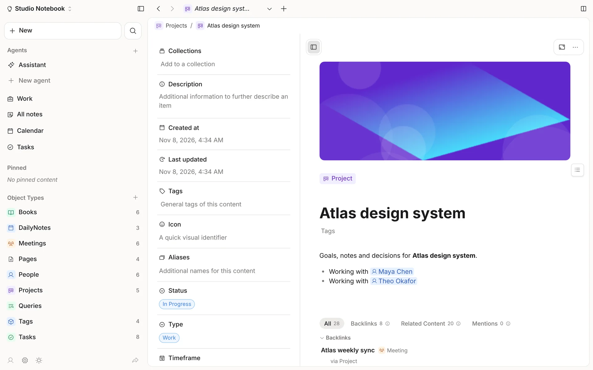
</picture>

<sub>Screenshots show a synthetic demo space. They follow your GitHub theme (light or dark).</sub>

</div>

---

## Contents

- [Why Object](#why-object)
- [A tour](#a-tour)
- [Features](#features)
- [Quick start](#quick-start)
- [Connect an AI assistant (MCP)](#connect-an-ai-assistant-mcp)
- [How it works](#how-it-works)
- [Develop](#develop)
- [Documentation](#documentation)

## Why Object

- **Your files stay yours.** Every object is a Markdown file with YAML frontmatter, in a folder you choose. Open it in any editor, put it in git, back it up however you like.
- **Structure without lock-in.** Types (Person, Project, Book, Meeting, anything you define) give notes properties, relations and views, and all of it is still readable text.
- **Careful with your data.** Opening a space never modifies its files. An edit changes only its own lines, line endings and BOM are kept, writes are atomic, and deletes go to a restorable trash.
- **Private by design.** The server listens on `127.0.0.1` only. There is no telemetry and no account. Objects marked "Exclude from AI" are never sent to a model.

## A tour

<table>
<tr>
<td width="50%">
<picture>
  <source media="(prefers-color-scheme: dark)" srcset="docs/images/gallery-dark.webp">
  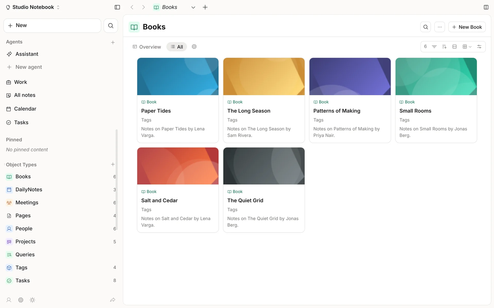
</picture>
<p align="center"><b>Gallery</b>: any type as cards with covers</p>
</td>
<td width="50%">
<picture>
  <source media="(prefers-color-scheme: dark)" srcset="docs/images/kanban-dark.webp">
  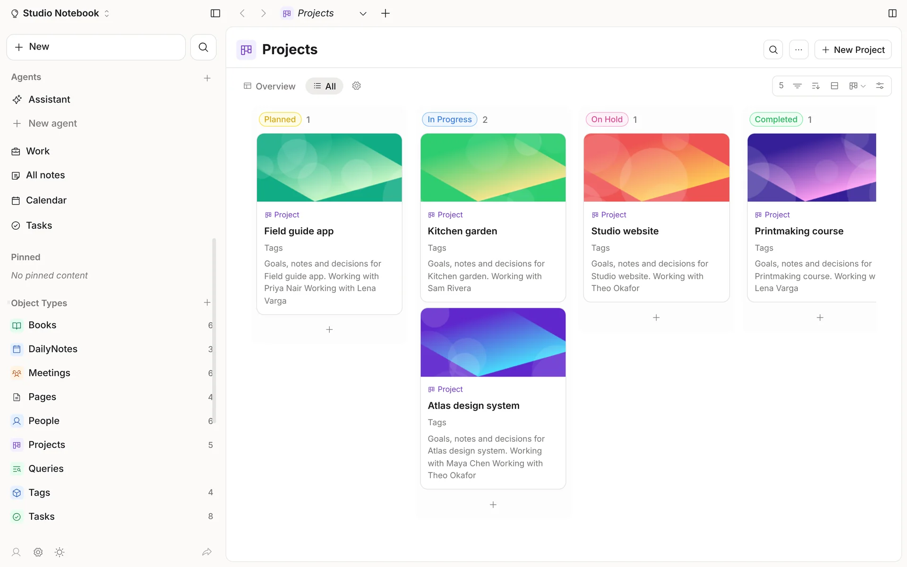
</picture>
<p align="center"><b>Kanban</b>: group by a label, drag to change it</p>
</td>
</tr>
<tr>
<td width="50%">
<picture>
  <source media="(prefers-color-scheme: dark)" srcset="docs/images/editor-dark.webp">
  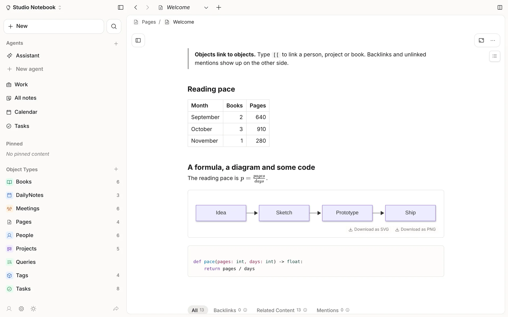
</picture>
<p align="center"><b>Editor</b>: tables, math, diagrams and code, saved as plain Markdown</p>
</td>
<td width="50%">
<picture>
  <source media="(prefers-color-scheme: dark)" srcset="docs/images/tasks-dark.webp">
  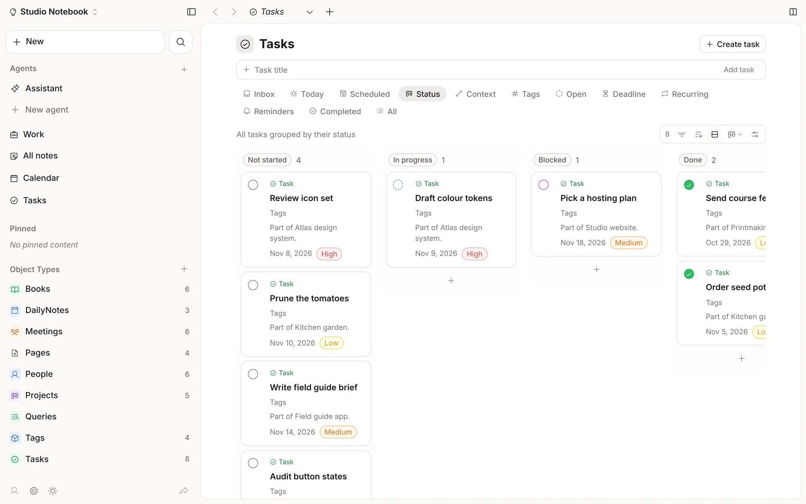
</picture>
<p align="center"><b>Tasks</b>: inbox, today, scheduled, status, recurring</p>
</td>
</tr>
<tr>
<td width="50%">
<picture>
  <source media="(prefers-color-scheme: dark)" srcset="docs/images/meetings-dark.webp">
  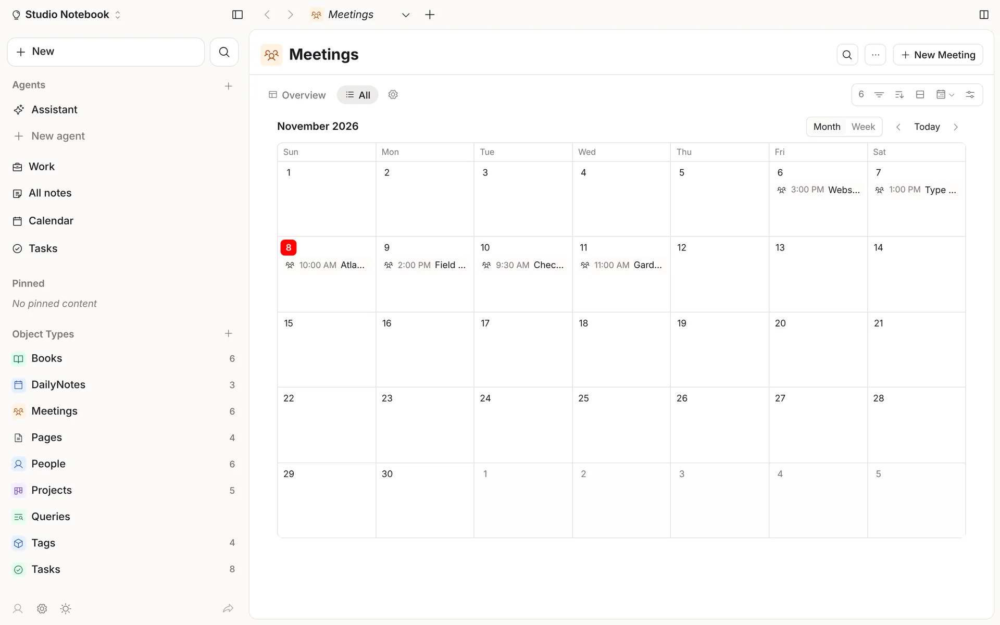
</picture>
<p align="center"><b>Calendar layout</b>: any type with a date, by month or week</p>
</td>
<td width="50%">
<picture>
  <source media="(prefers-color-scheme: dark)" srcset="docs/images/calendar-dark.webp">
  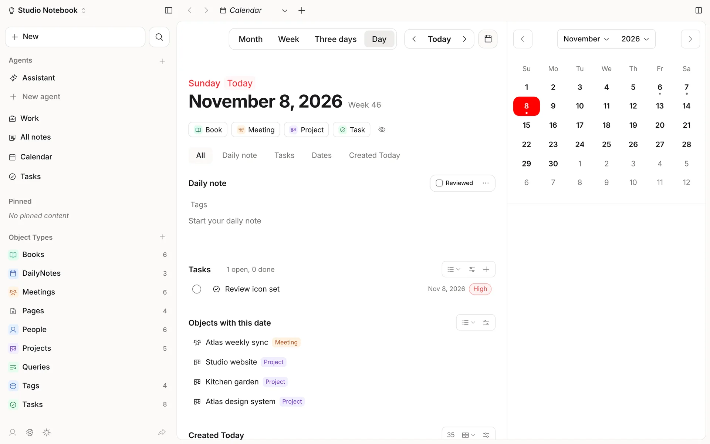
</picture>
<p align="center"><b>Daily notes</b>: the day's note, tasks and everything dated today</p>
</td>
</tr>
<tr>
<td width="50%">
<picture>
  <source media="(prefers-color-scheme: dark)" srcset="docs/images/search-dark.webp">
  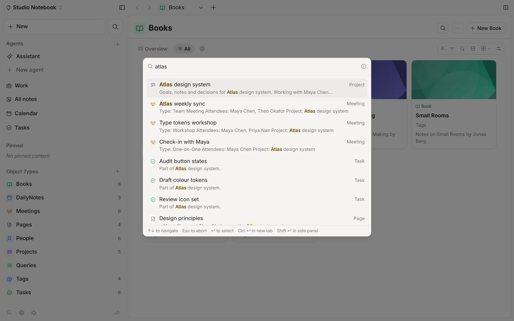
</picture>
<p align="center"><b>Search</b>: <kbd>Ctrl</kbd>+<kbd>K</kbd> full-text search across titles, bodies and properties</p>
</td>
<td width="50%">
<picture>
  <source media="(prefers-color-scheme: dark)" srcset="docs/images/graph-dark.webp">
  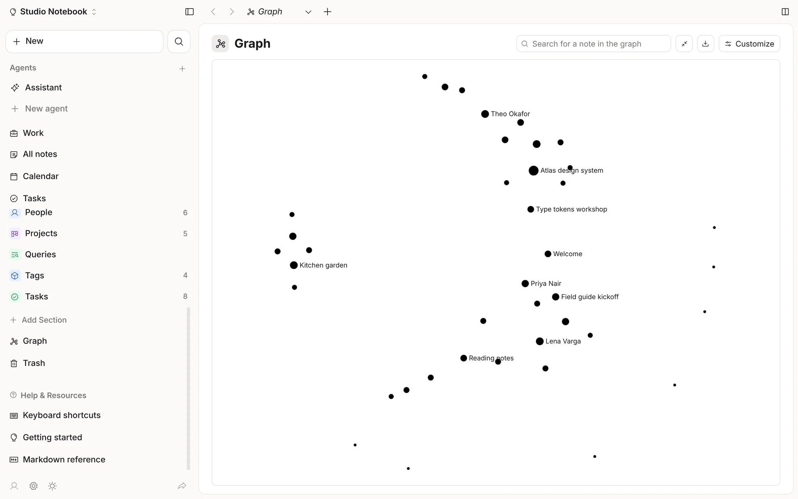
</picture>
<p align="center"><b>Graph</b>: every link between objects, global or local</p>
</td>
</tr>
<tr>
<td colspan="2">
<picture>
  <source media="(prefers-color-scheme: dark)" srcset="docs/images/work-dark.webp">
  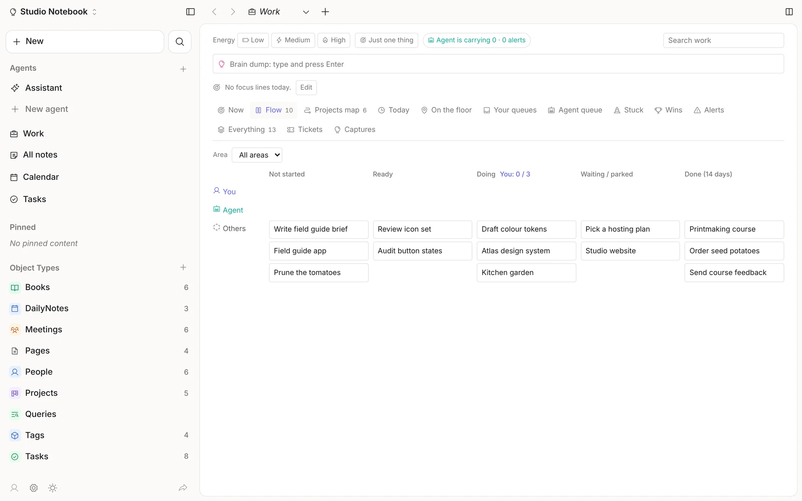
</picture>
<p align="center"><b>Work</b>: a dashboard over Tasks and Projects (Now, Flow, Projects map, queues, alerts), a brain-dump bar and a Work agent</p>
</td>
</tr>
</table>

## Features

| Area | What you get |
|---|---|
| **Objects and types** | Built-in and custom types; every property kind (text, number, date, label, relation, checkbox, URL, email, phone, files, color); Formula, Rollup and ID properties; templates; tags as objects; aliases; a restorable trash; version history |
| **Views** | List, Gallery, Wall, Table, Kanban, Calendar, Timeline, Chart and Embed layouts, with filters, sorts and group-by; collections; saved queries |
| **Writing** | A block editor that writes plain Markdown and never rewrites what you didn't edit: tables, to-dos, code with highlighting, KaTeX math, Mermaid diagrams, columns, toggles; light and dark themes; focus mode |
| **Time** | Daily notes; a calendar (day, three days, week, month); tasks with priority, deadline, recurrence and local reminders |
| **Links** | `[[wikilinks]]`, backlinks, related content and unlinked mentions; global and local graph; full-text search and the command palette |
| **Whiteboards** | Objects, text blocks, frames and images on a canvas, joined by connectors, with pressure-sensitive pen ink |
| **Automations** | Local rules triggered by creating an object, a property change, a schedule or a button |
| **AI and agents** | A chat panel with a model picker, run through your own `claude` CLI; agents that are Claude Code project folders with memory, self-written skills, an MCP gateway, remote A2A agents, delegation and schedules. Nothing is written without your say |
| **Tasks dashboard** | One page for every task and work item: it opens on Now, with Inbox, Today (the day's timeline over the same task list as the Calendar's day), your queues, the agent queue and Captures on one row, and the planning, list and review views (Flow, Projects map, Status, Deadline, Stuck, Wins, Alerts, Tickets…) folded under More views; a brain-dump bar that saves Captures; a Work agent that files them |
| **Version control and backup** | Each space can be its own git repository: changes are committed after a quiet spell, **Space history** shows every commit with its diffs and restores the whole space (or one object) to any point as a new commit, and a remote (GitHub, GitLab, any https or ssh address, with your own git credentials) gets pushed now or automatically. Off until you turn it on; history is never rewritten |
| **Import** | Notion, Obsidian and Anytype exports, Markdown folders and Files folders (Word, PDF, Excel, PowerPoint, HTML, images) into a new space, this space or a trial copy. Every imported object keeps a Source line; re-runs update instead of duplicating; a local sensitive-content scan runs first; an agent can propose a schema, which only you approve |
| **Local API and MCP** | A token-protected API on `127.0.0.1` and an MCP server, so Claude Code or Claude Desktop can search, query, read and (with a read-write token) edit your notes |

Every feature is simply available. Nothing is gated.

## Quick start

You need **Python 3.13+** with [uv](https://docs.astral.sh/uv/), and **Node 22+**.

```sh
uv sync
cd frontend && npm ci && npm run build && cd ..

uv run objectapp --space /path/to/space            # opens its own window
uv run objectapp --space /path/to/space --browser  # or in your browser
```

The server listens on `http://127.0.0.1:8790` only (`--port` changes the port). Only the window Object opens can use it: each launch makes a random key, and the window opens at a one-time `/_open` link that hands the key over as a session cookie. With `--browser` the launcher prints that link (it works once, for 5 minutes; press Enter in the terminal for a new one); a bare `http://127.0.0.1:8790` tab shows "This page isn't connected to Object". Other programs use the token API under `/api/v1` (see MCP below), which keeps its own tokens. Point `--space` at an empty folder to start fresh, or at an existing folder of Markdown files. A space keeps its metadata in `.object/` and a rebuildable search cache in `.object-cache/`.

AI features need the [Claude Code](https://docs.claude.com/en/docs/claude-code/overview) CLI (`claude`) installed and signed in. Everything else works without it.

## Connect an AI assistant (MCP)

Object has a local API for programs on the same computer, and an MCP server on top of it, so an assistant such as Claude Code or Claude Desktop can search, query and read your notes, and (with a read-write token) make careful edits.

1. Start Object, then open **Settings > Integrations** and create a token. Pick "Read only" unless the assistant should change notes. The token is shown once.
2. Copy the MCP config shown there into your client (Claude Code: `.mcp.json`; Claude Desktop: `claude_desktop_config.json`). It runs:

```sh
OBJECT_API_TOKEN=obj_... uv run --directory /path/to/objects objectapp-mcp
```

Object must be running: the MCP server talks to it over `http://127.0.0.1:8790/api/v1` and never opens the space itself, so every edit keeps the app's rules (version checks, only the changed lines, the trash, version history).

- Tokens are stored as hashes in the app's state folder, never in the space.
- Objects tagged "Exclude from AI", or with `excludeFromAI: true`, are invisible to every token.
- Writes made through a token are listed by `GET /api/v1/changes`.
- The routes are documented in `backend/objectapp/api_v1.py`.

## How it works

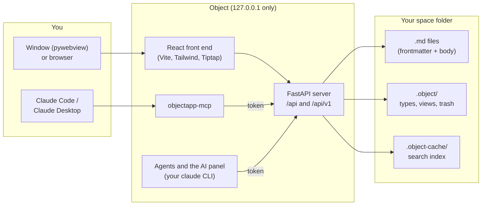

- **Back end:** Python with FastAPI, `ruamel.yaml` for frontmatter that keeps your formatting, SQLite FTS for search, `watchdog` for external edits. Every write goes through one engine: version check, only the changed lines, atomic replace, line endings and BOM kept.
- **Front end:** React 19 and TypeScript, built with Vite, styled with Tailwind and shadcn/ui; Tiptap for the editor, xyflow for whiteboards, sigma for the graph. Fonts and icons are bundled; nothing is fetched at runtime.
- **Agents:** each agent is its own Claude Code project folder, run through your own `claude` CLI. An agent sees only the tools its switches allow; apart from the Work agent, agents run without a shell and their file tools are fenced away from your space folders.

### Repository layout

```text
backend/objectapp/   the server, the storage engine, agents, import, the MCP server
backend/tests/       pytest suite and synthetic fixture spaces (no real data)
frontend/src/        the React app (editor, views, calendar, graph, whiteboard, work, agents)
scripts/             acceptance scripts per milestone, and the screenshot tooling
docs/                behaviour catalog, design specs, plans and status
```

## Develop

```sh
uv run pytest backend/tests -q                          # back end (~3,200 tests)
cd frontend && npx vitest run                           # front end (~3,900 tests)
npx tsc -b --noEmit && npx oxlint && npm run build      # types, lint, build
```

Every milestone has an acceptance script that runs on a copy of a fixture space, for example:

```sh
uv run python scripts/m1_roundtrip.py backend/tests/fixtures/space-sample
PYTHONPATH=scripts:backend uv run python scripts/m24_acceptance.py
```

The exact command for each is in its `docs/superpowers/plans/mN-acceptance.md`. For a front-end dev server, run `npm run dev` in `frontend/` (it proxies `/api` to `127.0.0.1:8790`).

The screenshots above are made from a synthetic demo space by `scripts/screenshots/` (see its README).

Rules for contributors, human or agent, are in [`CLAUDE.md`](CLAUDE.md). To pick the work up, read [`HANDOFF.md`](HANDOFF.md).

## Documentation

| Document | What it is |
|---|---|
| [`docs/README.md`](docs/README.md) | A map of all the documentation |
| [`docs/behavior-catalog.md`](docs/behavior-catalog.md) | How Object behaves: labels, menus, shortcuts and their order |
| [`docs/superpowers/specs/`](docs/superpowers/specs/) | Design specs: the object model, agents, the Work section, import and migration |
| [`docs/superpowers/plans/remaining-work.md`](docs/superpowers/plans/remaining-work.md) | Status: what is built, what is open |
| [`HANDOFF.md`](HANDOFF.md) · [`CONTINUE.md`](CONTINUE.md) | Where things stand, and how to resume work |

---

<sub>Object's application code is written from scratch. Keep this repository private.</sub>
