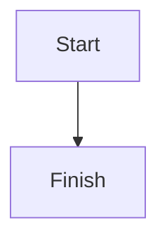

<!-- block: color=bg-blue align=center -->
## Rollout notes

<!-- block: small -->
Small print under the heading.

<!-- block: icon=ph-star -->
A paragraph with a star icon.

<!-- block: quote=standout -->
> Measure twice, cut once.

<!-- block: list=alphabetical -->
1. Alpha step
2. Beta step
   1. Nested beta detail
3. Gamma step

<!-- block: list=roman -->
1. First phase
   1. Nested first detail
2. Second phase

<!-- toggle -->
### Closed toggle
Hidden paragraph inside.
- Hidden bullet
<!-- /toggle -->

<!-- toggle open -->
### Server checklist
- [ ] Patch the hosts
Details in [[Embedded target]].
<!-- /toggle -->

<!-- group color=bg-gray -->
Box heading
Body of the box.
<!-- /group -->

<!-- columns widths=40,60 -->
Left side text.
<!-- column -->
Right side text.
<!-- /columns -->

<!-- columns layout=grid widths=33,33,34 -->
First cell.
<!-- column -->
Second cell.
<!-- column -->
Third cell.
<!-- /columns -->

<!-- block: wrap lock -->
```python
def greet(name):
    return "Hello, " + name + "! This line is long enough that wrapping matters in a narrow column."
```

<!-- block: preview=split -->


```markdown
# Preview heading

Some **bold** text.
```

$$
E = mc^2

a^2 + b^2 = c^2
$$

The theorem $a^2+b^2=c^2$ holds; the coffee was $5 and $6 for tea.

---

<!-- block: header-column -->
| Host | Role |
| --- | --- |
| alpha | web |
| beta | db |

<!-- block: no-header-row -->
| one | two |
| --- | --- |
| three | four |

<!-- block: width=120 align=center caption="A \"tiny\" pixel" -->


<!-- block: height=500 -->
![[Attachments/report.pdf]]

![[Attachments/clip.wav]]

![[Attachments/clip.mp4]]

![[Attachments/data.xlsx]]

<!-- block: bookmark -->
[Example docs](https://example.com/docs)

<!-- block: view=wideCard -->
![[Ada Lovelace]]

![[Embedded target]]
