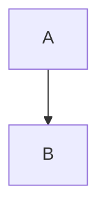

# Runbook

Status:: Active
Owner:: [[Ada Lovelace]]

Rack layout

Row *A*, slot 4.

* Prepare
    * Check power  
    * Check cables
        * Label both ends
* Run

1. First
2. Second

- [ ] open ticket
- [x] notify team

> Quoted *note*
> second line

|Host|Role|
|:---|---:|
|alpha|db|

***

Trailing	spaces   

